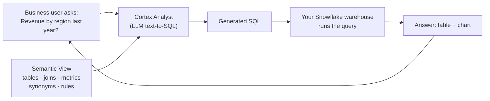

# Snowflake Cortex Analyst — Live Demo Guide

**Demo company:** Snowbird Outfitters, a fictional outdoor-gear retailer
**Demo length:** ~15 minutes + Q&A
**What the audience sees:** business questions typed in plain English, turned into correct SQL, answered with tables and charts — all inside Snowflake.

---

## 1. What's in this kit

| File | What it does | When |
|---|---|---|
| `01_setup_environment.sql` | Creates role, warehouse, database, and ~50k rows of realistic sales data | Day before |
| `02_create_semantic_view.sql` | Creates the semantic view (the AI's "dictionary") | Day before |
| `03_answer_key.sql` | Hand-written SQL for every demo question, so you can verify answers | Rehearsal |
| `04_streamlit_app.py` | "Ask Snowbird" chat app built on the Cortex Analyst REST API | Day before |
| `05_cleanup.sql` | Removes everything | After demo |

The data has five stories baked in so the answers are interesting on stage: revenue peaks every November/December; November margins dip because of Black-Friday discounts; the **Summit Pro Tent** is returned about 18% of the time (everything else about 4%); online share of orders grows steadily; and Business customers (clubs, scout troops, guide services) buy in much larger quantities.

---

## 2. Setup (do this the day before, ~20 minutes)

**Prerequisites:** a Snowflake account where you can use ACCOUNTADMIN. A free trial works. If your account is in a region without native Cortex Analyst support, uncomment the cross-region line in step 1.

1. **Run `01_setup_environment.sql`** in a Snowsight SQL worksheet (Projects → Workspaces/Worksheets). The final query should show 20 products, 500 customers and roughly 50,000 sales rows.
2. **Run `02_create_semantic_view.sql`** as `CORTEX_DEMO_ROLE`. The last query should return revenue by region. If the `AI_SQL_GENERATION` / `AI_QUESTION_CATEGORIZATION` lines cause an error, delete those two clauses and re-run; you can add the same instructions later in the Snowsight UI.
3. **Open the Cortex Analyst UI:** Snowsight → **AI & ML → Cortex Analyst** → select `CORTEX_DEMO_DB.RETAIL.SNOWBIRD_SALES_SV`. You'll see the semantic view editor with a chat/playground panel. Ask one test question.
4. **Create the Streamlit app:** Snowsight → **Projects → Streamlit → + Streamlit App**.
   - Name: `ASK_SNOWBIRD`, Location: `CORTEX_DEMO_DB.RETAIL`, Warehouse: `CORTEX_DEMO_WH`
   - Choose the **warehouse runtime** (the app uses the `_snowflake` module)
   - Replace the sample code with `04_streamlit_app.py`, click **Run**
   - If `pandas` fails to import, add it from the **Packages** menu
5. **Rehearse:** run `03_answer_key.sql` and note the key numbers (last year's revenue, the naive revenue, the top return-rate product). The data is random per setup run, so note them *after* your final setup.
6. **Add one verified query during rehearsal** (see Act 4) so you know where the buttons are.

### 30 minutes before you go on

Open these tabs in order: (1) SQL worksheet with `03_answer_key.sql`, (2) Snowsight Cortex Analyst with the semantic view open, (3) the Streamlit app, (4) this guide. Resume the warehouse by running any query. Zoom browser to ~125% so the back row can read. Click **New conversation** in the app. Have screenshots of each answer ready in case the Wi-Fi dies.

---

## 3. Run of show

### Act 1 — The problem (2 min, no clicks)

> "Every company has the same bottleneck. Someone in sales asks 'what was revenue in the West last quarter?' and it goes into a queue for the data team. It takes days, and when the answer comes back it sometimes disagrees with the dashboard because two people defined 'revenue' differently.
>
> Generic AI chatbots can write SQL, but they guess. They don't know that at our company revenue excludes returns. A confident wrong number is worse than no number.
>
> Cortex Analyst solves this with two things: an LLM that writes SQL, and a *semantic view* — a governed business dictionary that lives inside Snowflake next to the data."

### Act 2 — The data and the dictionary (3 min)

In the worksheet, briefly show the three tables (`SELECT * FROM SALES LIMIT 10`). Point out the raw columns: `DISCOUNT_PCT`, `IS_RETURNED`.

Switch to the **Cortex Analyst UI** and open the semantic view. Walk through three things only:

1. **Relationships** — "we told it once how sales joins to customers and products, so it never guesses a join."
2. **The `total_revenue` metric** — "revenue means after discounts, excluding returns. Written once, used by everyone."
3. **Synonyms** — "people say *sales*, *turnover*, *income*; they all map to the same metric."

> "Notice what the AI does *not* get: the actual data rows. It reads this metadata, writes SQL, and the SQL runs on our own warehouse under our own permissions."

### Act 3 — Ask questions (5 min, the heart of the demo)

Use the Cortex Analyst playground or the Streamlit app. Suggested sequence, from easy to impressive:

| # | Type this | What to point out |
|---|---|---|
| 1 | *What was our total revenue last year?* | Open the SQL. Show the `IS_RETURNED` and discount logic it applied. Then flip to the worksheet and run the **naive query** from the answer key — "a chatbot reading raw columns would have told the CFO this bigger, wrong number." |
| 2 | *Show me monthly revenue for the last 12 months* | Chart appears. "See the holiday spike in Nov/Dec." |
| 3 | *Break that down by channel* | **Follow-up question** — it remembers context. |
| 4 | *Which products have the highest return rate?* | Summit Pro Tent jumps out. "This is the kind of insight that sits hidden in a table." |
| 5 | *What's our gross margin by month?* | Three-table logic plus a derived metric. Point at the November dip: "Black Friday discounts eating margin." |
| 6 | *Who are our best customers?* | Ambiguous on purpose. It either asks a clarifying question / offers suggestions, or states its interpretation ("by revenue"). Either way: "It tells you how it interpreted you instead of silently guessing." |
| 7 | *How many employees do we have?* | Out of scope. It politely declines because of the custom instruction. "Guardrails are part of the model definition." |

**If an answer looks wrong:** stay calm and use it. Open the SQL, compare with the answer key, and say "this is exactly why the SQL is always visible and why we have verified queries." Then go straight into Act 4.

### Act 4 — Teach it (2 min): verified queries

In the Cortex Analyst UI, ask *What was revenue by region this year?*, check the SQL is right, and use the option to **add it as a verified query** (in the semantic view editor under verified queries). Ask a close variant like *revenue by territory for 2026* and point out that the response now reports it used a verified query (the Streamlit app shows a green ✅ banner for this).

> "The data team curates a library of trusted answers. The model uses them as examples, so accuracy improves over time, and users can see when an answer is backed by a verified query."

### Act 5 — Governance and wrap-up (2 min)

Show the 👍/👎 buttons in the app. "Feedback flows to the Monitoring tab so the data team knows which questions to fix."

Key closing points:

- **Data stays in Snowflake.** The generated SQL runs on your warehouse; role-based access control still applies, so a user can't see data their role can't see.
- **It's an API.** The same brain can sit behind Streamlit, Slack, Teams, or any app.
- **One definition of truth.** The same semantic view serves AI and BI tools (you can query it with plain SQL, as in step 2).

---

## 4. Likely Q&A — prepared answers

**"How accurate is it?"**
Accuracy depends mostly on the semantic view quality: clear descriptions, synonyms, sample values, and verified queries. Snowflake also provides evaluation tooling to test a semantic view against its verified queries and catch regressions. Always keep SQL visible for trust.

**"Does our data go to OpenAI / get used for training?"**
Snowflake states Cortex Analyst doesn't train on customer data. The model sees the semantic metadata and the question; the query results are produced by your warehouse. Models run within Snowflake Cortex, and admins can use model-level RBAC to restrict which models are allowed.

**"Which LLM does it use?"**
Snowflake picks automatically from a preference list (currently led by Anthropic Claude Sonnet models, then others), based on region and what your role is allowed to use. You can't pin a model directly.

**"What does it cost?"**
Billed per successful message (HTTP 200) for Cortex Analyst, plus normal warehouse credits to run the SQL. Usage is visible in `SNOWFLAKE.ACCOUNT_USAGE.CORTEX_ANALYST_USAGE_HISTORY`.

**"How is this different from Cortex Agents?"**
Cortex Analyst is the specialist for text-to-SQL on structured data. Cortex Agents orchestrate multiple tools (Analyst for tables, Cortex Search for documents, custom tools) and can answer questions that mix both. Snowflake currently recommends Cortex Agents for new builds, using the semantic view as the Analyst tool. The semantic view you built today carries over as-is.

**"Can it handle multiple data sets?"**
Yes. You can pass several semantic views in one request and it routes each question to the best one. It won't join across separate semantic views, so densely connected tables belong in one view.

**"What can't it do?"**
It answers questions that can be resolved with SQL. It doesn't see previous results (so "what's the revenue of the second product in that list?" won't work), it isn't built for open-ended "what trends do you see?" questions, and very long conversations with shifting intent can confuse it — start a new conversation.

**"Semantic model YAML vs. semantic view?"**
YAML files on a stage are the older approach and still supported. Semantic views are native Snowflake objects with RBAC, sharing and SQL support, and are the recommended approach.

**"How long did this take to build?"**
The semantic view is ~100 lines and could also be drafted automatically with Snowsight's Semantic View Autopilot from table metadata and query history. The app is ~200 lines of Python.

---

## 5. Troubleshooting

| Symptom | Fix |
|---|---|
| `Cortex Analyst is not enabled` / 403 | Check `ENABLE_CORTEX_ANALYST` is TRUE, the role has `SNOWFLAKE.CORTEX_USER` or `CORTEX_ANALYST_USER`, and enable cross-region inference if your region isn't supported. |
| Semantic view creation fails on `AI_SQL_GENERATION` | Delete the two `AI_...` clauses, re-run, add instructions via the Snowsight UI. |
| Semantic view error on `SAMPLE_VALUES` / `IS_ENUM` | Remove those lines; they're accuracy boosters, not required. |
| `ModuleNotFoundError: _snowflake` in Streamlit | The app was created on the container runtime. Recreate it on the warehouse runtime. |
| App says "SQL failed" | The role running the app needs SELECT on the tables (it owns them here, so check you're using `CORTEX_DEMO_ROLE`). |
| First answer is slow | Warehouse was suspended. Run a query 5 minutes before going on. |
| Answer differs from answer key | Check the SQL's date filter. "Last year" vs "last 12 months" is the usual culprit. |

---

## 6. Backup plan

Take a screenshot of each Act 3 answer during your final rehearsal and keep them in a slide at the end of your deck. If the network fails, say "let me show you what this looked like this morning" and walk through the screenshots with the same talking points. Audiences forgive broken Wi-Fi; they don't forgive a presenter who freezes.
